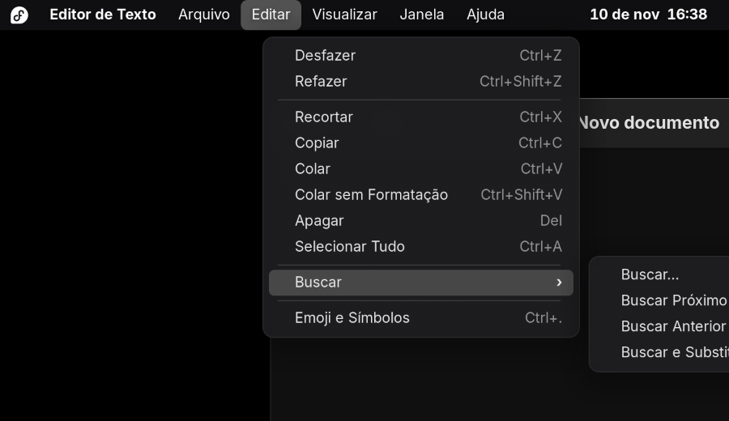
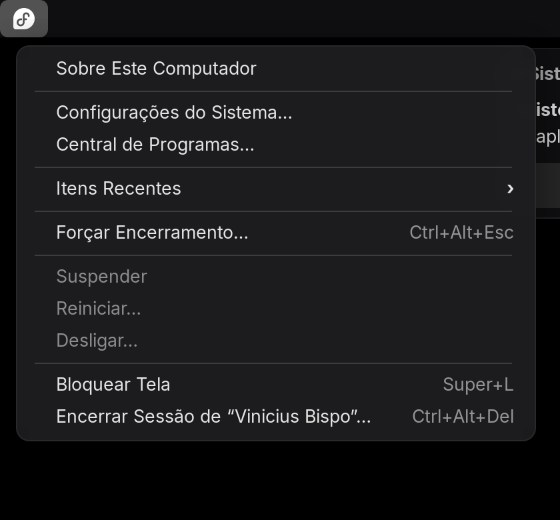
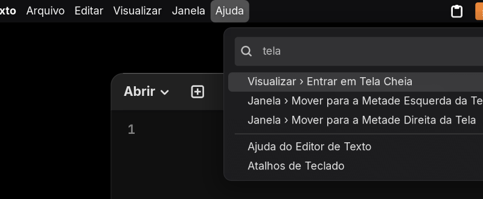
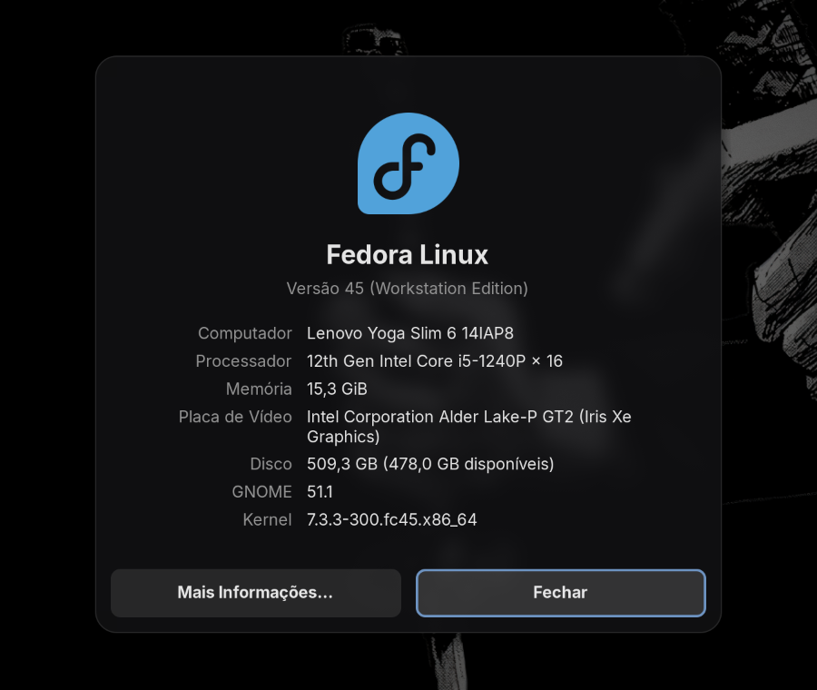
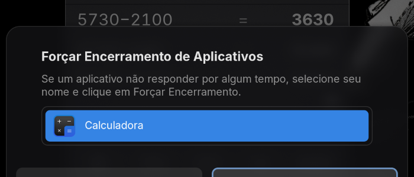
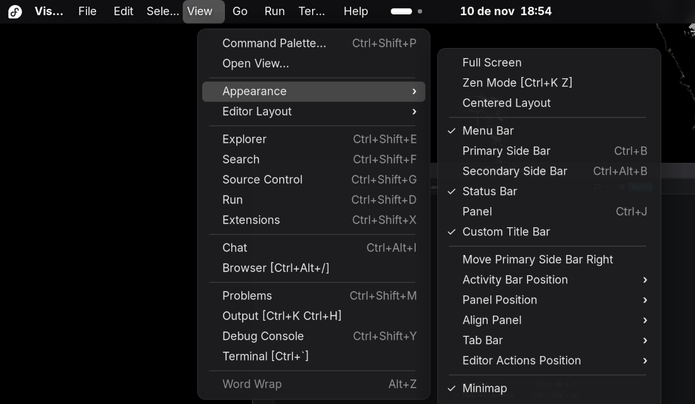
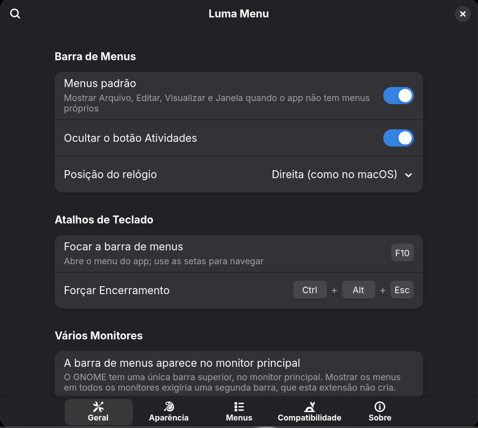

# Luma Menu

Barra de menus global no estilo do macOS para o **GNOME Shell 51**: o logo da sua
distro no lugar da maçã, o nome do aplicativo em negrito e os menus **Arquivo,
Editar, Visualizar, Janela e Ajuda** — ou os menus reais do app, quando ele os
exporta. Interface em português do Brasil.



## Sumário

- [O que ele faz](#o-que-ele-faz)
- [Instalação](#instalação)
- [Como funciona: as quatro camadas](#como-funciona-as-quatro-camadas)
- [O que funciona em cada tipo de app](#o-que-funciona-em-cada-tipo-de-app)
- [Limitações conhecidas](#limitações-conhecidas)
- [Preferências](#preferências)
- [Desenvolvimento](#desenvolvimento)
- [Referências: Fildem e Global Menu for GNOME](#referências-fildem-e-global-menu-for-gnome)
- [Licença e créditos](#licença-e-créditos)

## O que ele faz

- **Menu do sistema** (o logo): Sobre Este Computador, Configurações do Sistema,
  Central de Programas, Itens Recentes (apps e documentos), Forçar Encerramento
  (`Ctrl+Alt+Esc`), Suspender, Reiniciar, Desligar, Bloquear Tela e Encerrar Sessão —
  com os diálogos de confirmação nativos do GNOME.
- **Menu do app** em negrito: Sobre, Configurações, Ocultar, Ocultar Outros, Mostrar
  Tudo e Sair.
- **Menus do app**: os menus reais quando o app os exporta; senão, menus padrão
  no estilo macOS com todas as ações.
- **Busca no menu Ajuda**: procura em todos os itens de menu do app atual e mostra
  o caminho (`Editar › Buscar › Buscar…`). Enter executa.
- **Comportamento do macOS**: com um menu aberto, passar o mouse em outro título
  troca de menu; submenus abrem ao lado (em cascata); `F10` abre o menu do app para
  navegar pelo teclado; sem janela em foco, a barra mostra o **Arquivos** (como o
  Finder).
- Visual: cantos arredondados, fundo translúcido que respeita o tema (claro ou
  escuro), destaque com a cor de destaque do sistema, atalhos alinhados à
  direita, `✓` e `›`; animação curta que respeita "Reduzir animação".

| | |
|---|---|
|  |  |
|  |  |

## Instalação

Requisitos: GNOME Shell 51 (testado no Fedora 45, Wayland).

1. Desative a **Global Menu for GNOME**, se estiver instalada (as duas brigam pelo
   mesmo espaço do painel):

   ```bash
   gnome-extensions disable globalmenu@ShiroOSL.github.io
   ```

2. Clone e instale:

   ```bash
   git clone https://github.com/viniciusbispo19/luma-menu.git
   cd luma-menu
   ./scripts/install.sh
   ```

3. No Wayland o Shell não carrega extensões novas sem uma nova sessão. Encerre a
   sessão, entre de novo e ative:

   ```bash
   gnome-extensions enable luma-menu@viniciusbispo19
   ```

4. Abra as preferências:

   ```bash
   gnome-extensions prefs luma-menu@viniciusbispo19
   ```

## Como funciona: as quatro camadas

No macOS todo app entrega o seu menu ao sistema. No Linux não existe um padrão
único, então o Luma Menu escolhe, para cada janela, a melhor fonte disponível:

| Camada | Fonte | Quem usa | Como o Luma Menu lê |
|---|---|---|---|
| **A** | Menus GTK exportados (`org.gtk.Menus` + `org.gtk.Actions`) | Apps GTK com `GtkApplication` e barra de menus (ex.: LibreOffice) | O Mutter informa o nome D-Bus e os caminhos de cada janela; `Gio.DBusMenuModel` e `Gio.DBusActionGroup` leem o menu e as ações |
| **B** | DBusMenu (`com.canonical.dbusmenu`) registrado em `com.canonical.AppMenu.Registrar` | Apps Qt, Electron/Chromium — **via XWayland** | A extensão oferece o serviço Registrar; o app registra a janela (pelo id X11) e a extensão lê o menu |
| **C** | Ações do app sem barra de menus (GActions) | Apps GNOME modernos (menu "hambúrguer") | `app.about`, `app.preferences`, `app.quit`, `app.new-window`, `app.help`… alimentam os itens padrão |
| **D** | Menus padrão | Qualquer janela | Cada item usa, nesta ordem: a GAction do app (C), a API do Mutter (minimizar, tela cheia, fechar…) ou um atalho de teclado simulado (`Ctrl+C`…) |

Itens sem nenhum caminho garantido aparecem **em cinza**, como no macOS.

## O que funciona em cada tipo de app

Testado no GNOME 51.1 (Fedora 45):

| App | Sessão | Resultado |
|---|---|---|
| Editor de Texto, Calculadora, Arquivos e outros apps GNOME/libadwaita | Wayland | Camadas C + D: menus padrão; Sobre/Ajuda/Sair/Nova Janela usam as ações reais do app; edição por atalhos simulados |
| LibreOffice | Wayland (GTK 3) | **Camada A**: todos os 11 menus reais, traduzidos pelo próprio LibreOffice |
| VLC (Qt 5) | XWayland (`QT_QPA_PLATFORM=xcb`) | **Camada B**: menus reais com ícones e atalhos |
| VS Code (Electron) | XWayland (`--ozone-platform=x11`) + `"window.titleBarStyle": "native"` | **Camada B**: menus reais, submenus, itens marcados |
| Terminal (Ptyxis) | Wayland | Camada D com perfil de terminal: Copiar/Colar com `Ctrl+Shift+C/V`, Recortar em cinza (testado). Outros terminais usam o mesmo perfil, sem teste |
| Apps Qt/Electron em Wayland nativo | Wayland | Camada D (esses apps não registram menus no Wayland) |
| Firefox | — | **Não testado.** Em Wayland nativo o esperado é a camada D |

### Como ativar os menus reais de apps Qt e Electron

A camada B só funciona com o app rodando via **XWayland**:

- **Qt**: inicie com `QT_QPA_PLATFORM=xcb nome-do-app`.
- **VS Code / Electron**: inicie com `--ozone-platform=x11`. No VS Code, também é
  preciso `"window.titleBarStyle": "native"` nas configurações (com a barra de
  título personalizada, o próprio VS Code desenha o menu e não o exporta).

Para tornar isso permanente, copie o `.desktop` do app para
`~/.local/share/applications/` e acrescente a variável ou a opção na linha `Exec=`.



## Limitações conhecidas

Sem promessas falsas — o que **não** dá (ou ainda não dá) para fazer:

- **Wayland nativo × XWayland**: Qt e Electron só exportam menus DBusMenu no X11.
  Em Wayland nativo, esses apps ficam com os menus padrão.
- **Apps já abertos**: apps Qt/Electron registram o menu quando abrem. Se o Luma
  Menu (ou a opção "Ler menus de apps Qt, Electron…") for ativado com eles abertos,
  reabra-os. Bloquear a tela não perde os menus (veja abaixo); desativar e reativar
  a extensão perde.
- **Apps GTK 4/libadwaita** só exportam ações de aplicativo (`app.*`). As ações de
  janela (`win.*`) ficam dentro do app, então itens como Salvar e Desfazer usam
  atalhos de teclado simulados — funcionam na grande maioria dos apps, mas cada
  app escolhe seus atalhos.
- **"Metade esquerda/direita da tela"**: o GNOME 51 não oferece API pública de
  "lado a lado"; o Luma Menu aciona o seu atalho configurado
  (`Super+←`/`Super+→` por padrão).
- **Vários monitores**: o GNOME tem uma única barra superior, no monitor
  principal. A barra de menus aparece só nela.
- **Espaço no painel**: com muitos menus e muitos ícones de status, os títulos
  que não cabem são cortados na borda (o nome do app encolhe primeiro).
- **Artigos em pt-BR**: os textos seguem "Sobre o <App>" e "Sair do <App>"; não
  há como saber o gênero do nome de cada app ("Sobre o Calculadora").
- **Mnemônicos** (letras sublinhadas) não são exibidos.
- **Just Perfection**: se ela estiver controlando a posição do relógio, escolha a
  posição em um lugar só (o Luma Menu reaplica a dele poucas vezes, para não
  "brigar").

### Por que a extensão continua ativa na tela de bloqueio

O `metadata.json` declara `"session-modes": ["user", "unlock-dialog"]`. Por padrão o
GNOME desativa as extensões ao bloquear a tela; isso destruiria o serviço
Registrar e os apps Qt/Electron perderiam os menus a cada bloqueio. Durante o
bloqueio **apenas o Registrar** (um serviço D-Bus, sem nada na tela) continua
vivo; a barra, os atalhos e as mudanças no painel são removidos ao bloquear e
recriados ao desbloquear.

## Preferências



- **Geral**: menus padrão, ocultar Atividades, posição do relógio, atalhos
  (focar a barra, Forçar Encerramento).
- **Aparência**: logo (Fedora, Tux, GNOME, Ubuntu, Debian, Arch Linux, openSUSE,
  Linux Mint, Pop!_OS, Manjaro, NixOS, Zorin OS, elementary OS, Automático ou
  Personalizado), tamanho e estilo (simbólico/colorido), negrito no nome do app,
  espaçamento, estilo dos atalhos (`Ctrl+C` ou `⌃C`), opacidade e arredondamento.
- **Menus**: cada menu padrão, busca no Ajuda, itens do menu do sistema.
- **Compatibilidade**: Registrar DBusMenu, apps ignorados, modo de depuração.

Tudo é aplicado na hora, sem reiniciar a sessão.

## Desenvolvimento

```
luma-menu/
├── extension.js            enable()/disable() e ciclo de vida (bloqueio de tela)
├── prefs.js                preferências (GTK 4 + libadwaita, outro processo)
├── stylesheet.css
├── lib/
│   ├── menuBar.js          a barra, escolha da fonte de menus, F10
│   ├── titleButton.js      um título da barra (PanelMenu.Button)
│   ├── popup.js            menus no estilo macOS + submenus em cascata
│   ├── systemMenu.js       menu do logo
│   ├── appMenu.js          menu do app em negrito
│   ├── fallbackMenus.js    camada D
│   ├── menuSearch.js       busca do menu Ajuda
│   ├── actions.js          GAction, Mutter e teclado virtual
│   ├── windowTracker.js    janela/app em foco
│   ├── panelLayout.js      Atividades e relógio
│   ├── aboutDialog.js · forceQuitDialog.js · systemInfo.js · recentItems.js
│   └── sources/            camadas A (gtkMenuSource), B (registrar, dbusMenuSource), C (actionSource)
├── icons/                  logos + CREDITS.md
├── schemas/ · po/
├── scripts/                build, instalação, sessão aninhada, testes, traduções
└── dev/                    extensão auxiliar e app de teste (fora do pacote)
```

### Testar sem derrubar a sua sessão

O Wayland não permite reiniciar o Shell em uso. Os testes rodam num GNOME Shell
**aninhado** (dentro de uma janela), com uma **cópia** das suas configurações:

```bash
./scripts/dev-nested.sh
```

Com a sessão aninhada aberta, em outro terminal:

```bash
./scripts/nested-eval.sh 'Main.panel._leftBox.get_first_child().name'   # JS dentro do Shell
./scripts/nested-screenshot.sh                                         # print da tela
./scripts/nested-test.sh 10    # ativar/desativar 10× + bloqueio simulado, sem vazamentos
./scripts/nested-restart.sh    # reinstala e reinicia a sessão aninhada
./scripts/nested-stop.sh
```

A extensão auxiliar `dev/luma-menu-devtools@…` liga o "modo inseguro" do Shell
(necessário para Eval e prints) **somente** quando `LUMA_MENU_DEV=1`, variável que
só o `dev-nested.sh` define.

### Outras tarefas

```bash
npm install                        # ESLint (uma vez)
npm run lint
./scripts/update-po.sh             # extrai strings novas para po/
./scripts/compile-translations.sh  # confere e compila as traduções
./scripts/build.sh                 # gera build/luma-menu@viniciusbispo19.shell-extension.zip
```

### Checklist para publicar no extensions.gnome.org

- [x] Nada é criado no nível do módulo nem no construtor (só `Gio._promisify`,
      prática do próprio Shell); tudo nasce no `enable()`.
- [x] `disable()` desfaz tudo: barra, menus, sinais, proxies D-Bus, timers, atalhos,
      teclado virtual, Registrar e mudanças no painel (verificado por
      `scripts/nested-test.sh`: 10 ciclos sem atores, menus ou avisos sobrando).
- [x] Sem E/S síncrona no Shell (arquivos e D-Bus são assíncronos).
- [x] Logs só no modo de depuração.
- [x] `session-modes` com `unlock-dialog` justificado (veja acima) — mencionar na
      revisão.
- [x] Uso de API interna documentado: `Main.panel._leftBox/_centerBox/_rightBox`.
- [x] `shell-version` só com a versão testada (`51`).
- [x] Pacote gerado com `gnome-extensions pack` (sem `dev/`, `node_modules`, scripts).
- [x] Licença GPL-3.0 e créditos dos logos (`icons/CREDITS.md`).
- [ ] Testar numa sessão real com as extensões do dia a dia antes de enviar.
- [ ] Enviar o `.zip` em <https://extensions.gnome.org/upload/>.

## Referências: Fildem e Global Menu for GNOME

- **Fildem** (projeto antigo, hoje abandonado) lia os menus reais dos apps
  (GMenu e DBusMenu) e tinha busca nos menus no estilo HUD — a ideia por trás das
  camadas A/B e da busca do menu Ajuda. Mas dependia de X11, de um processo Python
  externo e do `appmenu-gtk-module`, e quebrou com o Wayland e as versões novas do
  GNOME.
- **Global Menu for GNOME** é simples e nunca fica vazia, porque os menus são
  fixos e as ações são atalhos simulados por um teclado virtual — o que equivale
  só à camada D. Não lê menus reais, os itens nunca ficam cinza e parte do código
  usa D-Bus síncrono.

O Luma Menu junta as duas ideias: menus reais quando existem (A/B/C), menus padrão
como rede de segurança (D), tudo assíncrono e dentro do próprio Shell. Nenhum
código desses projetos foi copiado.

## Licença e créditos

Luma Menu é software livre, sob a [GNU GPL versão 3 ou posterior](LICENSE).

Os logos vêm do [Simple Icons](https://simpleicons.org); origem, licença e
diretrizes de marca de cada um estão em [icons/CREDITS.md](icons/CREDITS.md).
Marcas registradas pertencem aos seus donos.

Autor: Vinicius Bispo — <https://github.com/viniciusbispo19>
